# OThreeJS
***1. Hafta: 3D Web'e Giriş ve Temel Kavramlar***

Web’de 3D Grafik Kütükhanesi: Three.js

Geliştirme Ortamının Kurulması (Node.js, Vite, VS Code)

Three.js’in Temel Yapı Taşları: Sahne (Scene), Kamera (Camera), Render Alıcı (Renderer)

Uygulama: İlk Three.js "Hello World" (Dönen Küp) sahnesinin oluşturulması.
<!-- 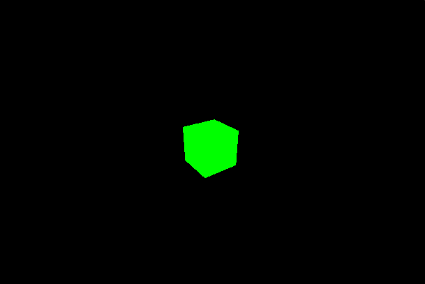 -->

***2. Hafta: Matematiksel Temeller ve Dönüşümler***

3D Uzayda Koordinat Sistemleri (X, Y, Z)

Vektörler (`Vector3`) ve Matrisler

Pozisyon (Position), Dönme (Rotation) ve Ölçekleme (Scale)

`Group` yapısı ile nesneleri hiyerarşik bağlama

Uygulama: Güneş Sistemi modeli (Güneş etrafında dönen gezegenler).

<!--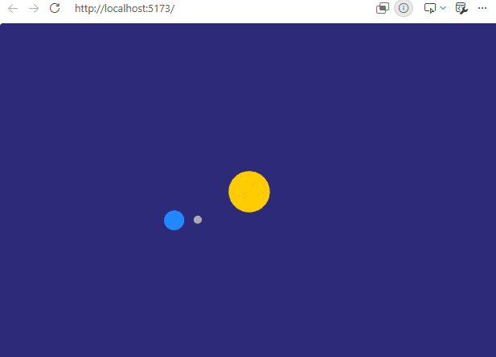-->

***3. Hafta: Kameralar ve Görüş Açıları***

Perspektif Kamera (`PerspectiveCamera`) vs. Ortografik Kamera (`OrthographicCamera`)

Kamera Parametreleri: FOV (Field of View), Aspect Ratio, Near/Far Düzlemleri

Kamera Kontrolleri: `OrbitControls` entegrasyonu ve özelleştirilmesi

Uygulama: İnteraktif ürün inceleme kamerası yapımı.

<!--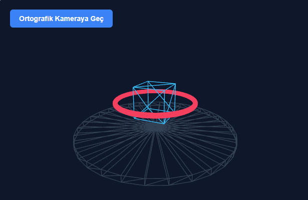-->

**4. Hafta: Geometriler – Temel Şekiller**

Yerleşik (Built-in) Geometriler: `Box`, `Sphere`, `Cylinder`, `Plane`, `Toru`s vb.

Segment ve Mesh Yapısı (Wireframe modunda inceleme)

Geometri Özellikleri ve `BufferGeometry` mantığına giriş

Uygulama: Çeşitli temel şekillerden oluşan 3D soyut bir kompozisyon oluşturma.

<!--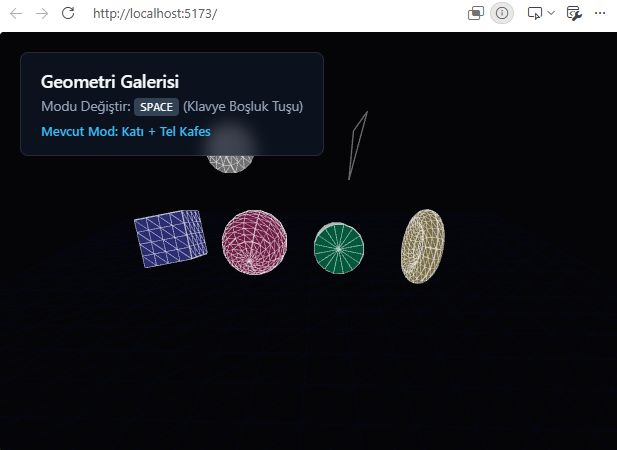-->

***5. Hafta: Materyaller (Materials) ve Yüzey Özellikleri***

Temel Materyaller: `MeshBasicMaterial`, `MeshLambertMaterial`, `MeshPhongMaterial`

Modern PBR (Physically Based Rendering) Materyalleri: `MeshStandardMaterial`, `MeshPhysicalMaterial`

Metalness, Roughness, Opacity ve Transparent ayarları

Uygulama: Farklı malzeme türlerinin (Cam, Metal, Plastik, Ahşap) görsel karşılaştırması.

<!--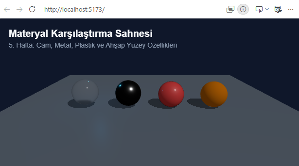-->

***6. Hafta: Işıklar (Lights) ve Gölgeler (Shadows)***
Işık Türleri: `AmbientLight`, `DirectionalLight`, `PointLight`, `SpotLight`, `HemisphereLight`

Light Helpers (Işık yardımcıları) ile çalışmak

Gölge Haritalama (Shadow Maps): Gölgeleri aktif etme, çözünürlük ve performans ayarları

Uygulama: Sinematik bir stüdyo aydınlatması ve gölge sahnesi hazırlama

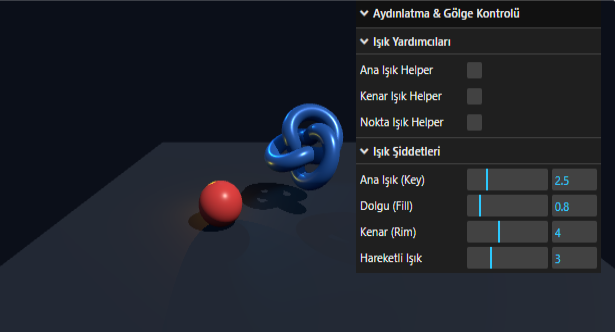

***7. Hafta: Kaplamalar (Textures) ve PBR Mimarisi***
Kaplama Yükleyici (`TextureLoader`) kullanımı

PBR Kaplama Haritaları: Color (Albedo), Normal, Roughness, Metalness, Ambient Occlusion (AO), Displacement Maps

Texture UV haritalama, Repeating, Offset ve Center ayarları

Uygulama: Gerçekçi bir taş/ahşap zemin ve küre yüzeyi kaplama.

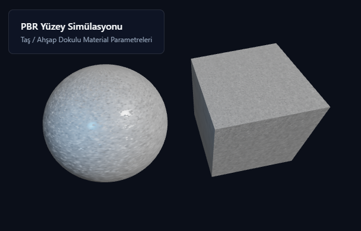

| AA | 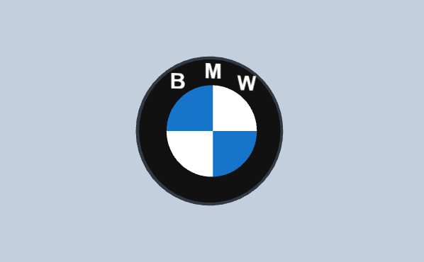 |
| ABO | 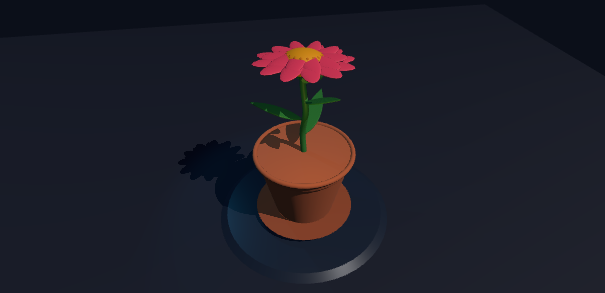 |
| AMA |  |
| BD | 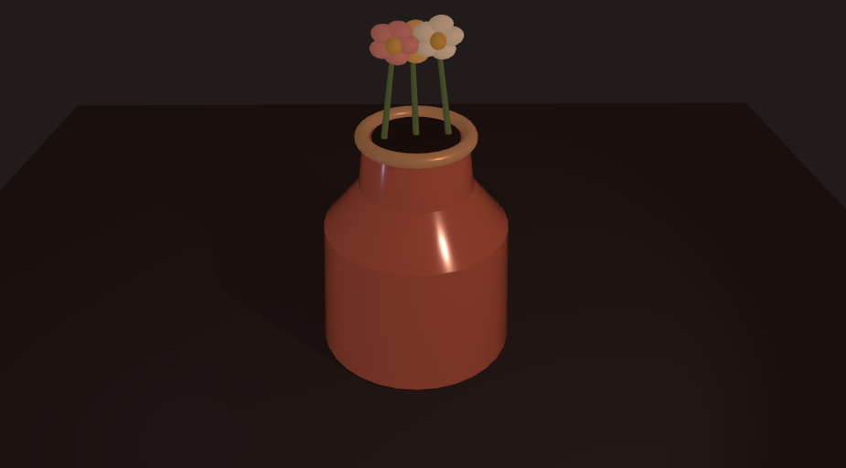 |
| BDM | 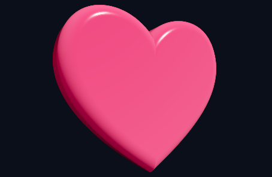 |
| CEE | 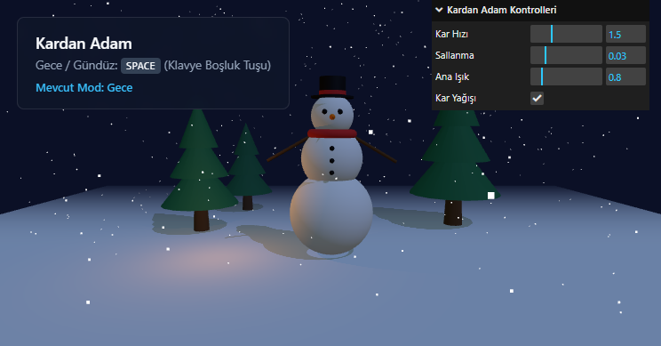 |
| EK | 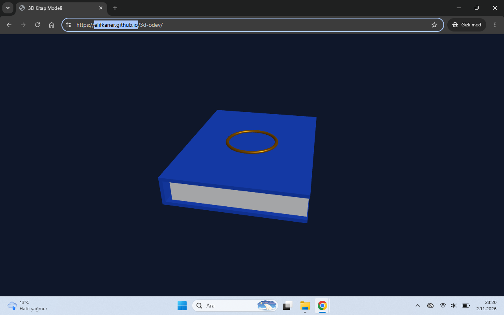 |
| İY | 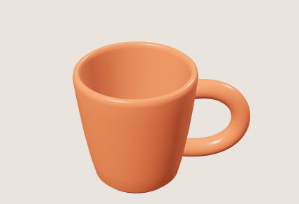 |
| İSD | 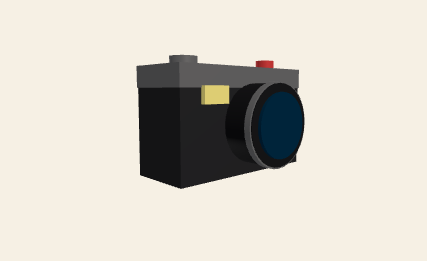 |
| MÜ |  |
| MHY | 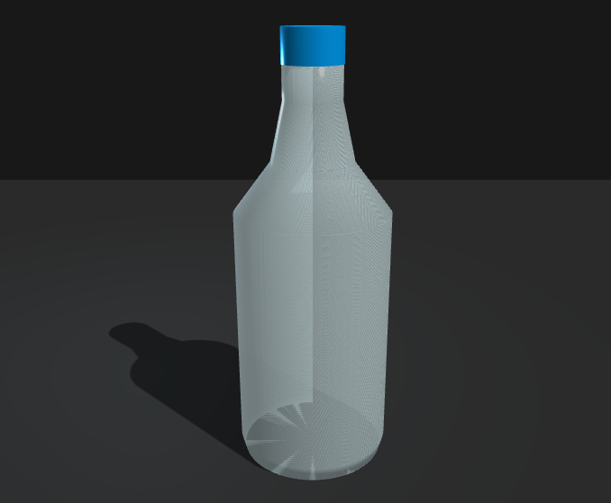 |
| MCÖ | 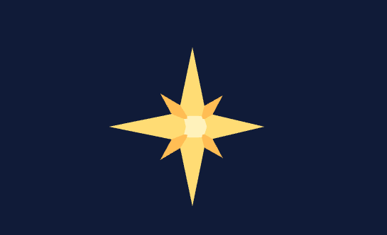 |
| SE | 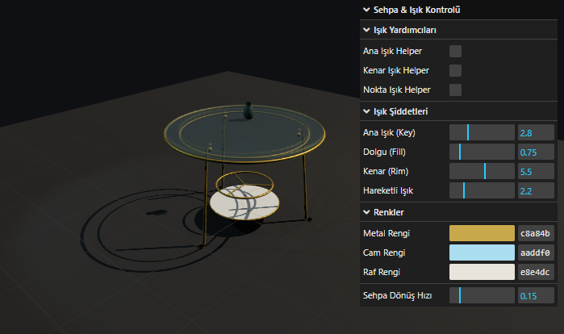 |
| ST |  |
| ŞA | 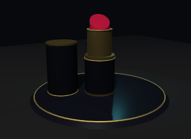 |

